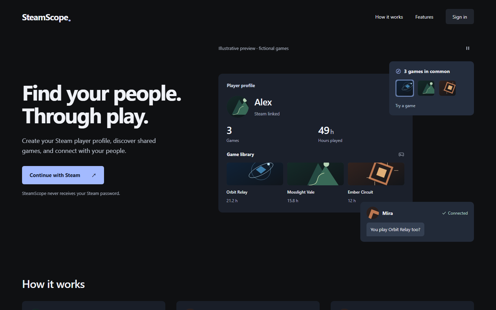
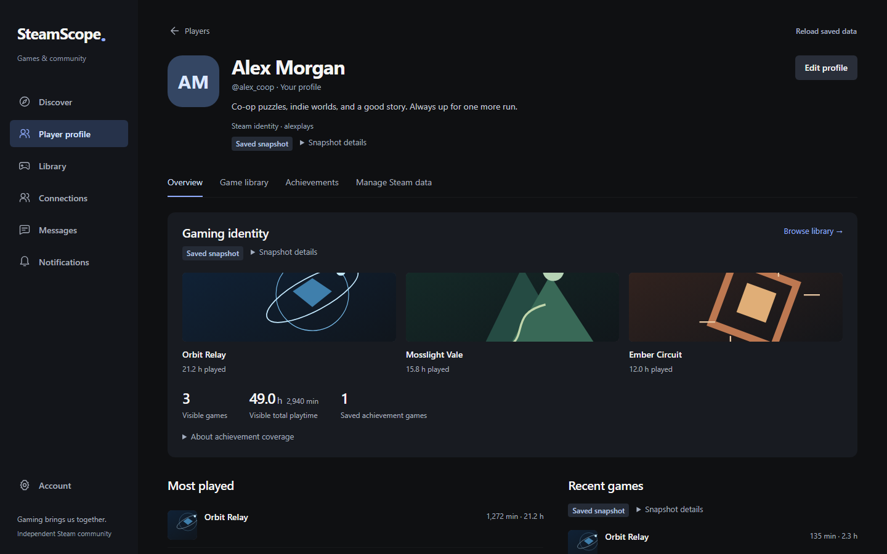
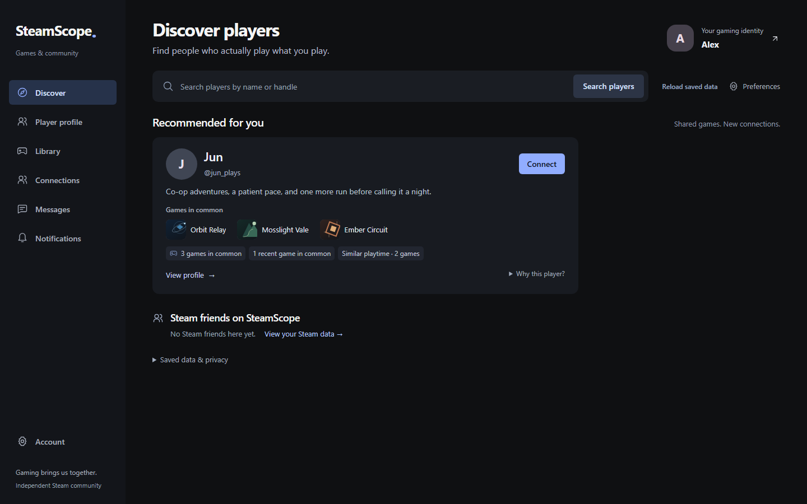
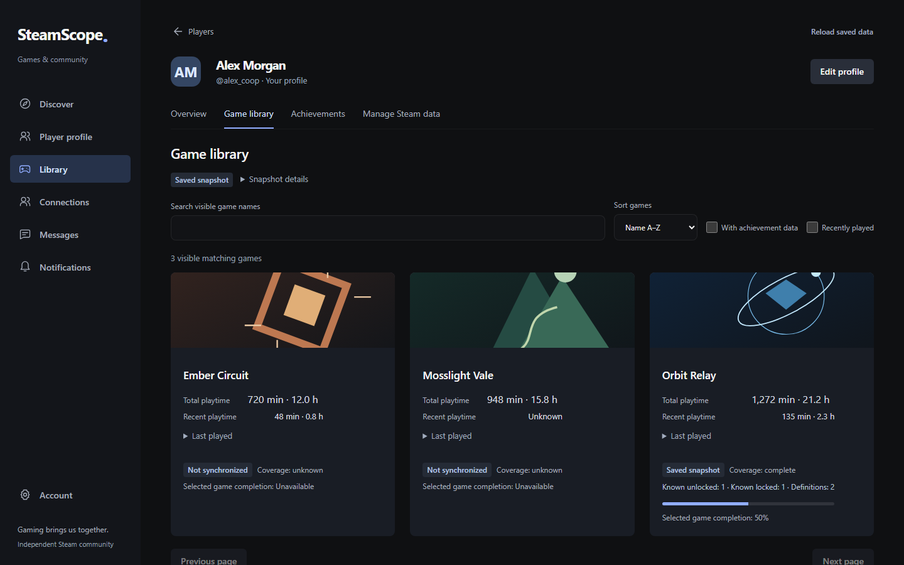
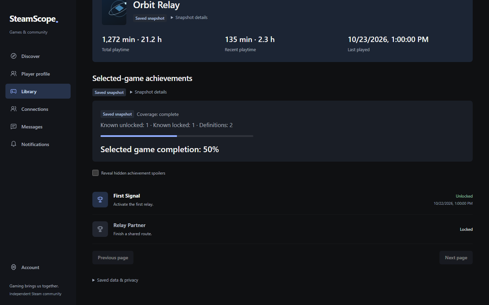
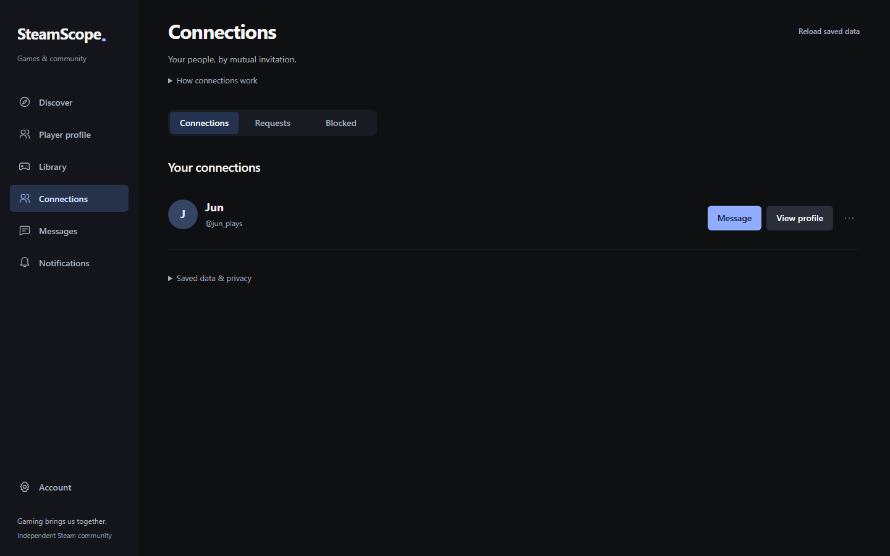
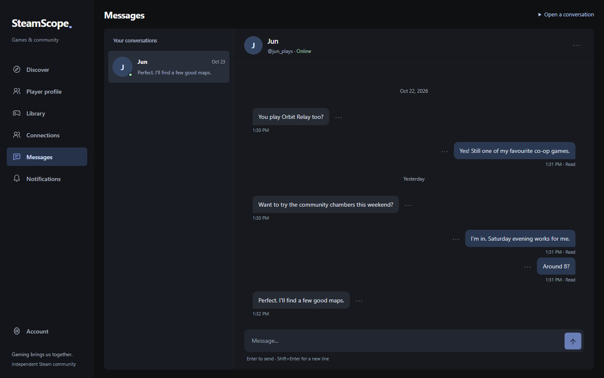
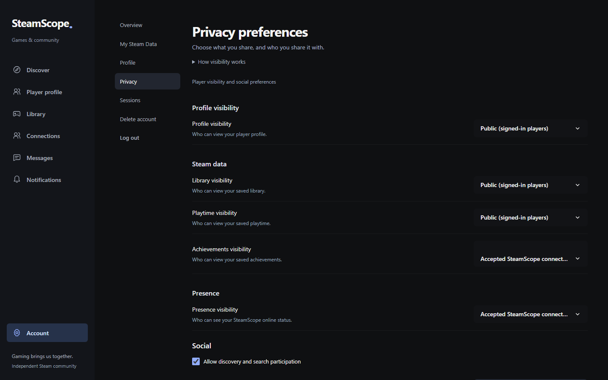
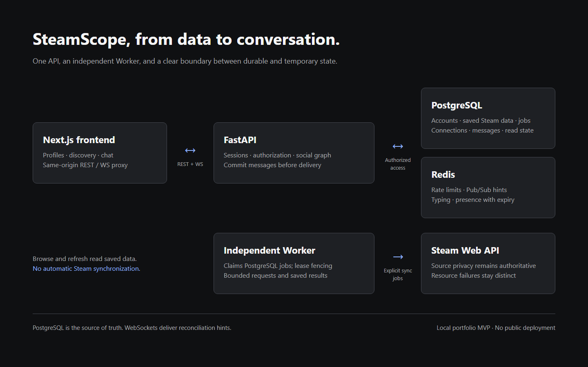
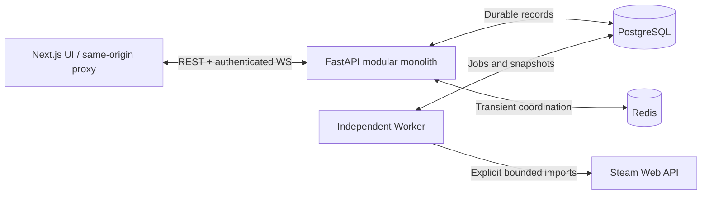

# SteamScope

**A Steam-data-driven social platform.**

Turn permitted gaming history into player profiles, find shared interests, connect by mutual consent, and start a conversation.



**Steam identity → Player profile → Discover → Connect → Chat**

**Status: Local MVP complete.** Production deployment and hardening are planned.

## What it does

- Steam OpenID login with server-managed, revocable sessions.
- Explicit imports of profiles, libraries, playtime, selected-game achievements and friends.
- Explained discovery using only authorized shared gaming evidence.
- Connection requests, consent, blocking, report intake and persistent notifications.
- Direct chat with durable history, real-time delivery, read state, typing and presence.
- Custom profile avatars with validated uploads and privacy-aware serving. [Storage policy](social/docs/security/AVATAR_STORAGE.md).
- Official Steam artwork for saved games, with high-resolution cards, compact thumbnails and graceful fallbacks. [Visual strategy](social/docs/architecture/GAME_VISUALS.md).

Browsing reads saved data; it does not synchronize with Steam. Unknown, empty, restricted and stale data remain distinct. A Steam friendship is not permission to message someone.

## Screenshots

All images below use **synthetic people, fictional games and authored sample chat**. They demonstrate the real interface, not platform usage or real Steam progress. Original geometric SVG artwork is included under MIT. [Captions and provenance](social/docs/portfolio/SCREENSHOT_INDEX.md).

| Player profile | Discover |
| --- | --- |
|  |  |
| **Game library** | **Achievements** |
|  |  |
| **Connection** | **Chat** |
|  |  |
| **Privacy** | **Architecture** |
|  |  |

## Architecture



PostgreSQL is the source of truth. Redis supplies delivery hints, rate limits, typing and presence; reconnecting clients recover messages from the database. [Architecture](social/docs/portfolio/ARCHITECTURE_OVERVIEW.md) · [Data model](social/docs/database/DATA_MODEL.md) · [Chat contract](social/docs/architecture/DIRECT_CHAT.md).

## Tech stack

Next.js 16, React 19, TypeScript, adapted Beautiful UI Free components, FastAPI, Pydantic, SQLAlchemy, PostgreSQL 17, Redis 7 and Alembic. Five-service Docker Compose provides the local environment. Versions are locked in `social/frontend/package-lock.json` and `social/backend/uv.lock`.

## Engineering highlights

- Durable import jobs with leases, fencing, bounded retries and deletion safeguards.
- Authorization before aggregate counts, comparisons and discovery scoring.
- Canonical relationship pairs and transaction-safe connection/block operations.
- Idempotent message IDs, commit-before-delivery and reconnect reconciliation.
- Resource-specific coverage/freshness: stale history is not a fabricated current percentage.

[Case study](social/docs/portfolio/CASE_STUDY.md) · [Architecture decisions](social/docs/adr/) · [Five-minute demo](social/docs/portfolio/PROFESSOR_DEMO.md).

## Validation

See the [candidate validation record](social/docs/development/VALIDATION.md) for actual local test counts, exit codes, independent container checks and scan limits. Historical owner-verified Steam and two-user chat acceptance is clearly separated from this candidate's deterministic tests and synthetic screenshots. [GitHub Actions](https://github.com/huakai531/SteamScope/actions/workflows/social-ci.yml) runs the isolated validation workflow. The linked validation record preserves actual results and earlier failures.

## Local development

Requires Docker Desktop/Linux containers, Python 3.12 and uv, and Node 22.14–24. Use the exact tested versions and isolated test databases described in the [development guide](social/docs/operations/DEVELOPMENT.md).

From the repository root in PowerShell:

```powershell
Set-Location social
.\scripts\dev.ps1 -Task setup
# Privately configure .env before first database initialization.
# Keep POSTGRES_PASSWORD and SOCIAL_DATABASE_URL credentials consistent.
docker compose --env-file .env config --quiet
.\scripts\dev.ps1 -Task up
```

Default frontend: http://127.0.0.1:3100/. Preserve existing volumes and environment files. Steam OpenID needs no Web API key; optional explicit synchronization uses a private server-side key. Automated tests use fixture Steam and need no real credentials.

## Current status

The local MVP covers identity, Steam data, profiles, discovery, consent-based connections and chat. This repository starts with a curated portfolio baseline; it is not presented as a single-step development history. Earlier private implementation/acceptance records are retained separately. No public hosted service is claimed.

## Roadmap

- Future game communities and Looking for Group under separate scope.
- Production hardening, monitoring, backup/restore and load testing before deployment.

## Security / Privacy

[Security reporting](SECURITY.md) · [Privacy model](social/docs/security/PRIVACY_MODEL.md) · [Threat model](social/docs/security/THREAT_MODEL.md) · [Current dependency status](social/docs/security/CURRENT_SECURITY_STATUS.md).

Never commit credentials or personal API/chat data. Public production deployment is not currently supported. Code and original demo art are [MIT-licensed](LICENSE); retain [third-party notices](social/frontend/THIRD_PARTY_NOTICES.md).

## Disclaimer

SteamScope is an independent project and is not affiliated with or endorsed by Valve Corporation. Xiaoheihe is product inspiration only; there is no affiliation. Steam data remains subject to source permissions and privacy. No production readiness, public hosted availability or large user base is claimed.
