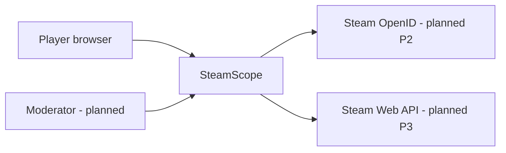
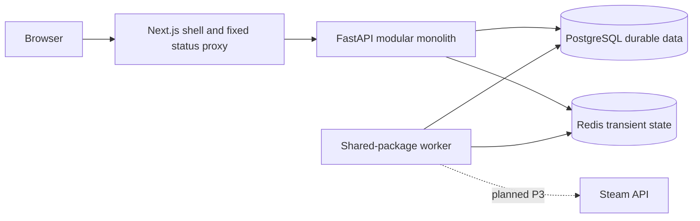
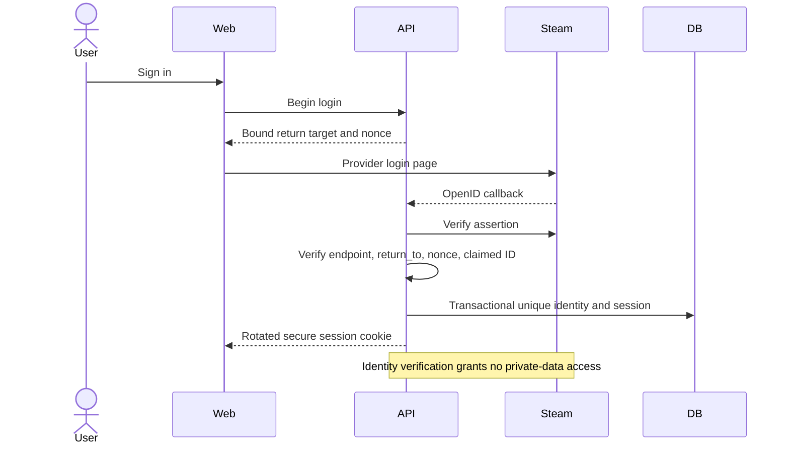
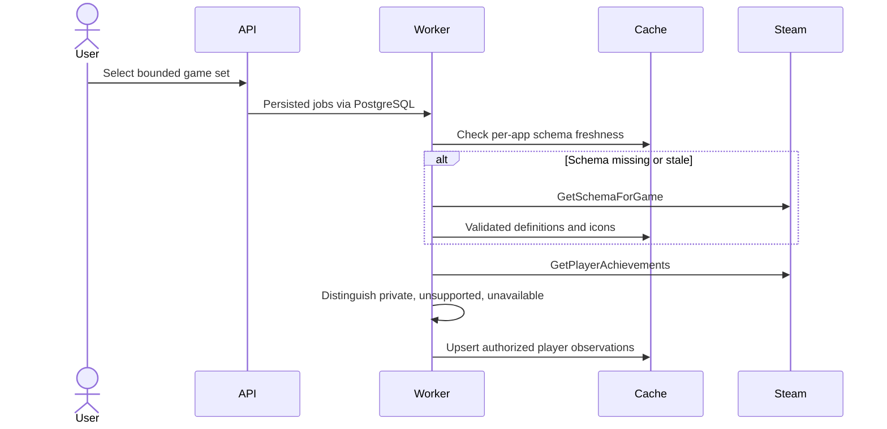
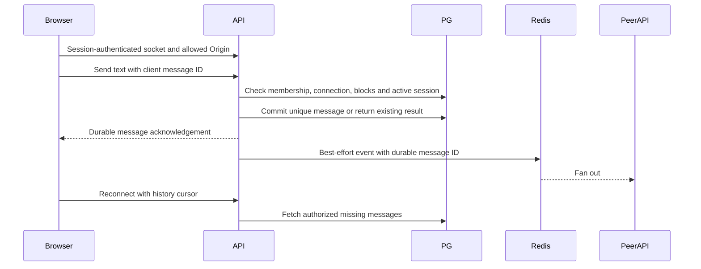

# Architecture diagrams

Only foundation components currently run. All business sequences are planned.

## 1. System context



## 2. Components



## 3. Steam login - planned P2



## 4. Initial synchronization - planned P3

```mermaid
sequenceDiagram
  participant API
  participant PG
  participant Worker
  participant Steam
  API->>PG: Insert deduplicated resource jobs
  Worker->>PG: Claim with lease and ownership token
  Worker->>Steam: Fetch outside transaction
  Steam-->>Worker: Accessible data or resource failure
  Worker->>Worker: Validate and normalize
  Worker->>PG: Check account generation and lease; atomic upsert
  Worker->>PG: Record per-resource run outcome
  API->>PG: Read partial status and freshness
```

## 5. Achievements - planned P3



## 6. Connection requests - planned P5

```mermaid
sequenceDiagram
  actor Sender
  participant API
  participant PG
  actor Recipient
  Sender->>API: Request connection
  API->>PG: Check actor, privacy, either-direction blocks
  API->>PG: Insert unique active canonical pair
  Recipient->>API: Accept request
  API->>PG: Lock request; recheck policy and recipient
  API->>PG: Accept and insert symmetric connection atomically
  API->>PG: Idempotent recipient notification
```

## 7. WebSocket message - planned P6



## 8. Blocking - planned P5/P6

```mermaid
sequenceDiagram
  actor User
  participant API
  participant PG
  participant Cache
  participant Socket
  User->>API: Block another user
  API->>PG: Commit directional block and cancel pending requests
  API->>Cache: Invalidate discovery and policy caches
  API->>Socket: Revoke interaction and presence subscriptions
  Socket->>PG: Recheck policy on next protected event
  Note over API,PG: Either direction blocks applicable interaction; unblock does not auto-restore requests
```
