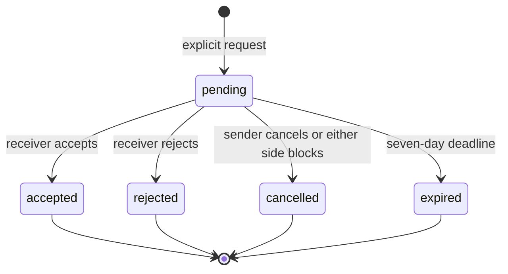

# Phase 5 social graph and discovery

All routes require a normal active session. Mutations use the existing exact Origin,
session-bound CSRF and Redis limits. There is no test authentication endpoint, chat,
WebSocket, presence, arbitrary SteamID import or Steam request on a social read.

## Relationships and concurrency

`connection_requests` is directed; `connections` is a canonical UUID-low/high pair;
`user_blocks` is directed storage with bilateral restrictions. External `steam_friends`
is a separate imported resource and grants no platform permission.

Requests last seven days. A same-direction pending retry returns the same object. A reverse
pending request returns 409 INCOMING_REQUEST_EXISTS and requires explicit acceptance.
Only the receiver accepts/rejects; only the sender cancels. Terminal retries of the same
transition return its result without creating a relationship again. Conflicting terminal
actions return 409. Expired requests are absent from pending lists; a transition marks them
expired, and a new send expires the old row before inserting its replacement.

Writes first verify session/Origin/CSRF and consume rate limits in the established auth
transaction, then release its actor lock. A new transaction identifies the pair, locks both
User rows in ascending UUID order, revalidates the session and target, and performs the action.
It never holds A's actor lock while waiting to acquire B->A in a competing transaction.
Profile/privacy changes and account deletion already lock the same User rows. No request row
is changed before pair locks. Acceptance, connection insertion and its notification commit
together. PostgreSQL independently enforces canonical/no-self pairs, a partial unique pending
pair index and unique notification event identity. Concurrent accept/block leaves no blocked
connection: either block prevents acceptance or deletes the just-created connection atomically.

Block removes a connection, cancels pending requests in both directions and deletes pair
notifications. No block/removal/rejection notification is emitted. Unblock deletes only the
actor's directional block, never restoring a request or connection. Imported Steam edges stay.
Generic SOCIAL_UNAVAILABLE/PLAYER_NOT_AVAILABLE responses hide reverse block existence.
The owner can manage their own explicit blocks and existing connections even if the other
profile is now private; these lists reveal only minimal platform relationship identity.

## Shared visibility policy

`modules/social/policy.py` supplies relationship facts and `Access.permits`; the existing
player projection uses it before rows, filters, counts, sums and comparison. Blocks deny
both directions. Accepted platform connections permit `connections` resources; imported
Steam friendship does not. Private remains owner-only even for accepted connections.
Source exposure and freshness still intersect with platform settings. Locale/timezone remain
owner-only and are not discovery signals. Owner history remains historical, not fresh evidence.

Search/discovery additionally require `discovery=true`, active verified linkage and an allowed
profile. This applies even to exact handles. No exact SteamID lookup is implemented. Search
is a literal, case-insensitive handle/display-name substring of 3..64 trimmed characters,
ordered by handle, capped at 20, with no total registered-user count or exhaustive cursor.
Persona search is not implemented. User text never enters glob, brace, filesystem or shell logic.

A request explicitly discloses only its sender's platform handle/name to its intended recipient
while pending, even if the sender's general profile is private. It does not share Steam data or
grant profile access. Notifications resolve current identity at read time; finalized events
hide a now-private actor. They store no full identity/profile payload or report content.
Owner relationship/block management may identify the user's own explicit relationship only.

Reads use the existing READ ONLY / REPEATABLE READ player transaction and revalidate sessions.
No authorization or discovery cache is stored. A completed privacy/graph change applies on
the next read; overlapping reads use their started snapshot. Frontend refetch/focus and
mutation invalidation hide stale projections, and logout/bfcache clear transient state.
Previously observed browser content cannot be retroactively erased.

## Visible-evidence-v1 ranking

Candidate privacy/block filtering occurs in SQL before the deterministic, handle-ordered pool
of at most 60 existing accounts. Only those candidates' authorized projections are scored.
Results are the top 20 positive scores, ordered by descending score then handle. No exhaustive
discovery pagination exists; a bounded pool is not a claim of globally optimized ranking.

`score = 10*min(M,5) + 10*min(R,3) + 5*min(P,2) + 10*F` (0..100).

- M: mutual visible app IDs, only when both libraries are current and exposed.
- R: those mutual games with known positive recent minutes on both fresh recent lists.
- P: mutual games with two known positive visible lifetime values where smaller*2 >= larger.
  Unknown and zero give no similarity signal; neither is coerced into evidence.
- F: 1 only when the viewer's fresh exposed imported friend snapshot matches the candidate's
  verified Steam account. The target must independently pass discoverability/profile/block rules.

Explanations state these exact visible counts or the imported-friend match. Private values
cannot affect scores, reasons or order. Unavailable mutual/recent evidence is null, not 0.
Zero-score users are omitted; sparse accounts get truthful empty results. No AI, statistical
optimization, skill rating, language/timezone inference or placeholder users are claimed.
Unmatched SteamIDs are never returned by discovery; no account creation or automatic connection.

## Limits, notifications and reporting

All per-actor keys use the existing namespaced Redis hash scheme and fail closed with 503
when Redis cannot enforce them. Search 30/minute; discovery+friend discovery share 15/minute;
social lists/relationship reads share 60/minute; requests 10/minute and 50/day; block/unblock
share 30/minute; other pair actions 30/minute; reports 3/hour. Writes also retain the existing
general sensitive-action limit. Failed valid-shape attempts and retries consume limits.
Rate-limited responses retain the established Retry-After:60 minimum; an hourly/day window
can require longer, explained in UI. This bounds abuse, not a production anti-scraping guarantee.

Notification events: `connection_request_received` to receiver, `connection_request_accepted`
to sender. Unique `(recipient_id,request_id,kind)` prevents duplicate logical notifications.
Unread/read transitions are recipient-only and idempotent. Lists use viewer-bound projection
pagination (25/page); pending requests and notification history are capped at newest 1000.
Connections/blocks list only the authenticated owner's explicit relationships. No public
social graph or moderator-report listing endpoint exists.

Reports allow six enumerated categories and <=1000 characters; no self-report. Same actor,
target and reason within 24 hours reuses the receipt without replacing evidence. Reports do
not block or notify. They survive connection removal and blocking. Retention is 90 days from
creation; normal users cannot read another person's report, description or reporter identity.
Database deletion trigger clears report descriptions whenever either account is deleted;
SET NULL FKs de-identify the deleted party. Remaining category/status/times and surviving party
reference are restricted moderation evidence, not exposed in player APIs.

Account deletion cascades requests, connections, blocks and notifications (including actor
references); report retention follows the preceding rule. Clearing imported Steam data removes
Steam evidence but preserves the platform graph. Existing explicit administration cleanup
purges expired reports, notifications and request history after 90 days. No unattended scheduler
is installed; 90 days is the cutoff, not a wall-clock purge guarantee. Operational scheduling
and moderation administration are prerequisites for any later public release.

## Storage and migration

0004_phase5_social adds five tables and the report-redaction trigger, touching no existing
snapshot columns or rows. Downgrade refuses any nonempty Phase5 table. Rollback testing is
limited to the isolated disposable migration database; development upgrades are additive only.
No production auth bypass, development fixtures, raw Steam responses or secrets are included.

Routes and current validation: [API](../api/API_OUTLINE.md), [Phase5 report](../development/VALIDATION.md).
