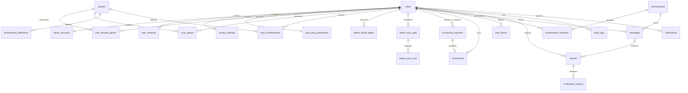
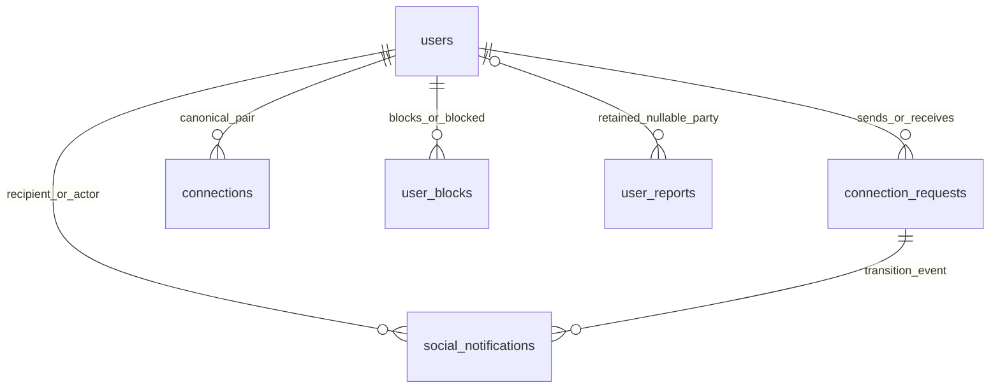

# Full planned MVP data model

## Implemented Phase 2 schema (authoritative)

Migration 0001_phase2_accounts creates exactly the following six tables; all other roadmap
entities below remain design-only unless implemented by the Phase 3A/3B/5 sections below. See MIGRATIONS.md and ADR 0021 for baseline deviations.

| Table | Current fields / key invariants | Deletion |
|---|---|---|
| users | UUID; unique lower(handle); bounded platform fields; locale/timezone; active/disabled/deleting; UTC created/updated | Hard-delete |
| steam_accounts | UUID; unique user_id and decimal-text steam_id; linked_at/verified_at | User cascade |
| user_sessions | UUID; user_id; unique SHA-256 token_digest; created/authenticated/last_seen/expiry/revoked; expiry > creation | User cascade |
| privacy_settings | user_id PK; profile/library/playtime/achievements/presence enum; discovery bool; request/message policy | User cascade |
| login_attempts | state_digest PK; browser_digest; purpose; allowlisted destination; optional bound user/session FKs; UTC expiry | Bound user/session cascade; expiry cleanup |
| audit_logs | UUID event id; nullable actor_id; bounded event; UTC creation | Actor SET NULL; >90-day cleanup |

Phase 3A now adds import_generation and job fencing on the established Steam relation. No per-device/IP
metadata is collected. Locale/timezone live on users; user_play_preferences is deferred.
Conservative privacy defaults are private/false/nobody. Defaults and UUID generation are
explicit ORM application defaults; SQL migration defines constraints, not fake domain data.

## Implemented Phase 3A extension (authoritative)

Revision 0002_phase3a_steam_sync is additive to 0001. Steam metadata stays on steam_accounts:
import_generation (default 0), persona_name, validated profile_url/avatar_url, source_visibility.
These never overwrite users fields. All times are UTC; SteamID64 remains decimal text.

| Table | Owner/source and constraints | Retention/deletion |
|---|---|---|
| games | Shared Steam app metadata; bigint app_id PK (1..2^32-1), optional name/icon hash | No owner identity; retained after account/data clear |
| user_games | Owner + app composite PK/FKs; nullable integer total/recent minutes, actual optional last_played_at, observed_at | Complete-library replacement only; user cascade/clear |
| steam_recent_games | Owner + app composite PK; nullable total/recent minutes, observed_at | Separate captured window; complete replacement; user cascade/clear |
| steam_resource_states | Owner + resource composite PK; resource CHECK; status/code, attempt/success times, snapshot UUID, exposed flag | User cascade/clear; visibility enforced on reads and aggregates |
| steam_sync_jobs | UUID PK; user and established link FKs; generation, status CHECK, attempts, availability/lease/finish UTC, claim token, safe outcomes JSON | Partial unique active-user index; claim index; max 20 histories on enqueue; account cascade |
| steam_sync_runs | UUID PK; job cascade FK/index, unique claim token, attempt and start/finish, safe outcomes | At most configured attempts per job; no raw payload/key/SteamID |
| steam_request_budgets | Scope+owner PK; fixed-window time/counter, shared blocked_until | Shared counters retained; per-user UUID bucket removed on account deletion, preserved on import clear to prevent quota bypass |

The source/snapshot policy and timestamp meanings are in [STEAM_DATA_FLOW](../architecture/STEAM_DATA_FLOW.md).
Library cursor uses snapshot UUID plus app ID; an updated snapshot rejects old page cursors.
Account deletion/clear and final job persistence lock users first, then jobs/link, and check
generation/claim/lease in that transaction. No HTTP occurs with a held DB transaction.
The Phase 3B section below implements achievement and imported-friend entities with the actual table names. Phase 5 implements platform connections below; messages remain future-only. The original 3A active-user index is superseded by the 3B scoped index.

## Retained MVP roadmap (future design where not overridden above)

UUID is the internal user identifier. SteamID64 is decimal text at storage/API boundaries. All timestamps are timezone-aware UTC. Foreign-key deletion behavior is explicit below; no blanket cascade over moderation evidence.

## users

- Purpose: Platform identity/profile.
- Owner / target: `users`, Phase 2.
- Primary key: `id UUID`.
- Foreign keys: none.
- Constraints / expected indexes: unique lower(handle); handle/status CHECK constraints. Future sync adds deletion generation.
- Privacy: Profile visibility applies; bio is user text.
- Source of truth / deletion: Account owner; atomic Phase 2 hard-delete; future asynchronous domains must add fencing.

## steam_accounts

- Purpose: Verified external identity.
- Owner / target: `auth`, Phase 2.
- Primary key: `id UUID`.
- Foreign keys: user_id -> users.
- Constraints / expected indexes: unique user_id and unique steam_id text; verified_at required; decimal ID validation.
- Privacy: SteamID linkage is identity data, not access authorization.
- Source of truth / deletion: Verified callback source; delete association on account purge; never import legacy subjects.

## user_sessions

- Purpose: Revocable server sessions.
- Owner / target: `auth`, Phase 2.
- Primary key: `id UUID`.
- Foreign keys: user_id -> users.
- Constraints / expected indexes: unique token_digest; indexes user_id and expires_at; expires_at > created_at.
- Privacy: Never expose token hashes; no device/IP metadata collected in Phase 2.
- Source of truth / deletion: Auth source; cascade delete and revoke sockets on deletion.

## privacy_settings

- Purpose: Field and interaction visibility.
- Owner / target: `privacy`, Phase 2.
- Primary key: `user_id UUID`.
- Foreign keys: user_id -> users.
- Constraints / expected indexes: one row per user; enum constraints for each policy.
- Privacy: Owner-only writes; restrictive defaults documented.
- Source of truth / deletion: User settings source; cascade delete.

## user_play_preferences

- Purpose: Language, timezone and LFG preferences.
- Owner / target: `users`, deferred until play/LFG preferences exist.
- Primary key: `user_id UUID` (planned).
- Foreign keys: user_id -> users.
- Constraints / expected indexes: one row per user; valid IANA timezone; bounded language list; language index when used.
- Privacy: Visible only where user opts in.
- Source of truth / deletion: User source; cascade delete.

## user_favorite_games

- Purpose: Explicit game favorites.
- Owner / target: `users`, Phase 3.
- Primary key: `user_id,app_id`.
- Foreign keys: users; games.
- Constraints / expected indexes: unique pair; reverse app_id,user_id index.
- Privacy: Respect profile/game preference visibility.
- Source of truth / deletion: User source; cascade user deletion; deleting Steam snapshots need not delete explicit favorites.

## games

- Purpose: Shared app catalogue.
- Owner / target: `steam`, Phase 3.
- Primary key: `app_id uint32-compatible bigint`.
- Foreign keys: none.
- Constraints / expected indexes: appid positive bounded; title index; source and observed_at.
- Privacy: Public game metadata only.
- Source of truth / deletion: Steam source; retain shared catalogue when one user deletes.

## user_games

- Purpose: Owned games and playtime observations.
- Owner / target: `steam`, Phase 3.
- Primary key: `user_id,app_id`.
- Foreign keys: users; games.
- Constraints / expected indexes: unique pair; minutes >=0; index app_id,user_id; resource status and observation time.
- Privacy: Library visibility; unknown != zero; hide previously public snapshots when source becomes private.
- Source of truth / deletion: Steam observation source; cascade subject deletion; reconcile only validated complete snapshots.

## achievement_definitions

- Purpose: Localized achievement schema/icons.
- Owner / target: `steam`, Phase 3.
- Primary key: `app_id,api_name,language`.
- Foreign keys: app_id -> games.
- Constraints / expected indexes: unique triple; schema version and observed_at; index app_id.
- Privacy: Public definition; display hidden-description rules deliberately.
- Source of truth / deletion: Steam schema source; shared cache retained until expired/replaced.

## user_achievements

- Purpose: Player unlock observations.
- Owner / target: `steam`, Phase 3.
- Primary key: `user_id,app_id,api_name`.
- Foreign keys: users; games.
- Constraints / expected indexes: unique triple; unlocked boolean, nullable unlock timestamp; index user_id,app_id.
- Privacy: Achievement visibility; API name is stable identity independent of locale.
- Source of truth / deletion: Steam player observation; cascade subject deletion; logical schema lookup by app/API name across languages.

## steam_friend_edges

- Purpose: Observed external Steam friendship.
- Owner / target: `steam`, Phase 3.
- Primary key: `owner_user_id,friend_steam_id`.
- Foreign keys: owner_user_id -> users.
- Constraints / expected indexes: unique pair; external friend ID string; observed_at; friend ID lookup index.
- Privacy: Owner source privacy and discovery permission; no registration side effect.
- Source of truth / deletion: Steam source; purge on subject deletion or source retention expiry.

## steam_sync_jobs

- Purpose: Durable resource scheduling.
- Owner / target: `steam`, Phase 3.
- Primary key: `id UUID`.
- Foreign keys: user_id -> users; nullable app_id -> games.
- Constraints / expected indexes: unique active dedup_key; index status,available_at; attempts/lease/token/generation constraints.
- Privacy: Worker-only writes; no upstream keys/payload dumps.
- Source of truth / deletion: Application source; cancel and fence on deletion; purge identifiers after cleanup.

## steam_sync_runs

- Purpose: Per-attempt outcomes.
- Owner / target: `steam`, Phase 3.
- Primary key: `id UUID`.
- Foreign keys: job_id -> steam_sync_jobs.
- Constraints / expected indexes: unique job_id,attempt; start/end; safe error category; resource scope index.
- Privacy: Owner-safe status projection; internal diagnostics restricted.
- Source of truth / deletion: Worker source; bounded 30-day operational retention, redact subject on deletion.

## connection_requests

- Purpose: Directed consent requests.
- Owner / target: `social`, Phase 5.
- Primary key: `id UUID`.
- Foreign keys: sender_id,recipient_id -> users.
- Constraints / expected indexes: nonself; partial unique canonical pair WHERE pending; recipient,status index.
- Privacy: Only parties and authorized moderation; either block direction denies.
- Source of truth / deletion: Platform source; state machine and acceptance transaction; purge with account.

## connections

- Purpose: Accepted symmetric relationships.
- Owner / target: `social`, Phase 5.
- Primary key: `user_low,user_high`.
- Foreign keys: both -> users; accepted_request_id -> connection_requests.
- Constraints / expected indexes: CHECK low < high; unique pair; index high; unique accepted request.
- Privacy: Relationship access governed by policy; does not mirror Steam.
- Source of truth / deletion: Platform source; remove connection transactionally; purge with account.

## user_blocks

- Purpose: Directional block decisions.
- Owner / target: `social`, Phase 5.
- Primary key: `blocker_id,blocked_id`.
- Foreign keys: both -> users.
- Constraints / expected indexes: nonself; unique directional pair; reverse index blocked_id,blocker_id.
- Privacy: Do not disclose which party blocked; both directions deny interaction.
- Source of truth / deletion: User source; purge with account; unblock does not auto-reconnect.

## conversations

- Purpose: Direct conversation identity.
- Owner / target: `chat`, Phase 6.
- Primary key: `id UUID`.
- Foreign keys: user_low,user_high -> users.
- Constraints / expected indexes: unique canonical direct pair; nonself; created_at index.
- Privacy: Only authorized members; require accepted connection at creation/send.
- Source of truth / deletion: Platform source; close access at deletion; retain/tombstone history per policy.

## conversation_members

- Purpose: Membership and read cursor.
- Owner / target: `chat`, Phase 6.
- Primary key: `conversation_id,user_id`.
- Foreign keys: conversations; users; nullable last_read_message_id -> messages.
- Constraints / expected indexes: unique pair; user_id,updated_at index; cursor must belong to same conversation and move forward.
- Privacy: Member-only state; presence preferences separate.
- Source of truth / deletion: Platform source; remove membership on deletion; no new group semantics until Phase 7.

## messages

- Purpose: Durable text and dedup identity.
- Owner / target: `chat`, Phase 6.
- Primary key: `id UUID`.
- Foreign keys: conversation_id -> conversations; sender_id -> users.
- Constraints / expected indexes: unique conversation_id,sender_id,client_message_id; index conversation_id,created_at,id; bounded text.
- Privacy: Member authorization on every read/send; body excluded from routine logs.
- Source of truth / deletion: User source; sender delete tombstone; account deletion removes body/attribution according to policy; report evidence separate.

## reports

- Purpose: Restricted user/message abuse evidence.
- Owner / target: `moderation`, Phase 5.
- Primary key: `id UUID`.
- Foreign keys: reporter_id,target_user_id -> users; optional message_id -> messages in P6.
- Constraints / expected indexes: bounded reason/evidence; status,created_at index; dedup fingerprint window.
- Privacy: Reporter and authorized moderators only; no general message browsing.
- Source of truth / deletion: User submission source; bounded retention; pseudonymize deleted accounts.

## moderation_actions

- Purpose: Review decisions and enforcement.
- Owner / target: `moderation`, Phase 5.
- Primary key: `id UUID`.
- Foreign keys: report_id -> reports; moderator_id -> users.
- Constraints / expected indexes: append-only action/outcome; index target/status/time.
- Privacy: Restricted role and audited access.
- Source of truth / deletion: Moderator source; bounded 90-day retention after resolution by default.

## audit_logs

- Purpose: Sensitive action evidence.
- Owner / target: `administration`, Phase 2.
- Primary key: `id UUID`.
- Foreign keys: nullable actor_id -> users.
- Constraints / expected indexes: event and UTC time; created_at index; no arbitrary metadata.
- Privacy: No tokens, private messages, passwords or raw upstream URLs.
- Source of truth / deletion: Application source; SET NULL actor on deletion; executable cleanup removes events older than 90 days.

## notifications

- Purpose: Durable recipient inbox.
- Owner / target: `notifications`, Phase 5.
- Primary key: `id UUID`.
- Foreign keys: recipient_id -> users; optional actor_id -> users.
- Constraints / expected indexes: unique recipient,event_key; index recipient,read_at,created_at.
- Privacy: Recipient-only; re-evaluate blocks/privacy before delivery.
- Source of truth / deletion: Platform source; cascade recipient deletion; minimize actor payload and expire 30 days.

## Cross-table invariants
An accepted request and canonical connection commit together. A request/connection race uses
row/advisory pair locking plus uniqueness; application checks alone are insufficient.
Blocks are directional rows but authorize neither direction of interaction while either exists.
Messaging transactions serialize policy changes at a documented boundary; a commit before a
block is historical, a send authorized after the block must fail. Session revocation affects sockets.

Jobs carry account deletion_generation and lease token. The account is marked deleting and
its generation advanced before cleanup; every handler rechecks active status/generation/lease
in the same transaction as its write. Late HTTP responses cannot recreate deleted records.
Client message IDs are scoped to sender and conversation; repeated identical content returns
the original persisted result, while conflicting content is rejected.

Achievement definitions are localized; player achievement identity is locale-independent.
The logical app/API-name schema relation must not force absence of one locale to delete
player progress. Source privacy is per resource, not inferred globally from player summary.

## ER diagram (planned)

## Implemented Phase 3B extension (authoritative over roadmap names)

Revision `0003_phase3b_steam_details`, parent `0002_phase3a_steam_sync`: five additional tables,
18 domain tables total and 21 foreign keys (migration test checks actual metadata).

| Actual table | Identity, source and fields | Deletion / snapshot semantics |
|---|---|---|
| steam_achievement_schemas | PK (app_id, language); app FK to games; English CHECK; status/code, revision SHA-256, attempt/success, lease token/until, retry_at | Shared nonpersonal cache survives owner clear/delete; failed refresh preserves previous definitions/revision/success |
| steam_achievement_definitions | PK (app_id, language, api_name); composite FK to schema ON DELETE CASCADE; bounded display_name/description, hidden, validated icon references | Valid complete schema replaces definitions; personal progress has no FK to these rows, preventing destructive cascade |
| steam_achievement_states | PK (user_id, app_id); user FK CASCADE and game FK; status/code, attempt/success, snapshot UUID, exposed, schema_revision/language | Per-owner/per-game state; clear erases, account cascade; unknown/denied hides personal values |
| steam_user_achievements | PK (user_id, app_id, api_name); user FK CASCADE and game FK; nullable unlocked/unlocked_at, observed_at | Complete validated player snapshot replaces personal rows, including resets/removals; unknown IDs retained with explicit partial status |
| steam_friends | PK (user_id, friend_steam_id64); owner FK CASCADE only; valid decimal-text individual SteamID64 CHECK; nullable friend_since, observed_at | No friend users FK or registration; only complete validated list reconciles removals; owner clear/cascade |

Composite primary keys supply owner/app or app/language lookup indexes and prevent duplicates.
`steam_resource_states` reuses `(user_id, resource)` for friends; no second friend status table.
`steam_sync_jobs` adds scope and app_id, default base/0 for historical jobs. Scope CHECK permits
base/0, friends/0, achievements/positive uint32 app. `uq_sync_active_scope` replaces the old active
index with unique `(user_id, scope, app_id)` for queued/running/retry; existing claim/run indexes remain.
The queue's app_id is a scope identifier, not an extra game FK; server eligibility is rechecked.

Cache identity includes English; TTL default 86400 seconds is application policy, not Valve's update
frequency. A 30-second shared lease prevents stampedes; failed attempts retry no sooner than 60s and
respect larger backoff. No DB transaction spans HTTP. Fresh exact percentage requires compatible
revision, all applicable definition IDs and explicit player booleans; zero/partial/unknown/stale
coverage has no percentage. Counts remain separately labelled known counts.

Friends use snapshot UUID + SteamID keyset pagination; achievements use snapshot + schema revision +
API-name keyset pagination. Replacement rejects old cursors. Personal jobs/runs containing selected
app relationships are erased on clear; base safe history and durable shared quotas follow prior policy.
Finished history is pruned to 19 on enqueue; at most 5 active scoped jobs can coexist per owner.

## Phase 3C integrated source-of-truth review (2026-10-22)

Current authority is the implemented Phase 2/3A/3B tables above; roadmap entities are not present.
Verified steam_accounts identifies a UUID user; its persona columns are imported metadata, not the
platform display name. games supplies shared app metadata; user_games stores lifetime minutes;
steam_recent_games is an independent captured window, never summed into lifetime totals.
App/English schema + definitions contain no owner progress. UserAchievement is owner/app/API-name
evidence; AchievementState binds its saved revision/time/exposure. SteamFriend is an external edge,
with no target users FK, registration side effect or SteamScope connection. SyncJob/SyncRun describe
attempts and leases, while resource states describe saved data; active/stale views are derived, not
another persisted authority. API Steam IDs stay strings; internal ownership stays UUID-based.

Phase 3C fixes destructive replacement of an existing player snapshot by an incomplete observation:
before deleting rows, mismatched schema/ID/boolean coverage returns unknown/SCHEMA_PLAYER_MISMATCH.
Prior rows, revision, snapshot ID and success time remain; reads hide progress until valid recovery.
A first bounded partial observation can still be retained as partial/known counts, never exact
completion. Complete matching data is required to replace an existing snapshot destructively.
See test_steam_acceptance and the [final report](../development/VALIDATION.md).

## Phase 4 derived reads (no schema migration)

The existing 18 business tables remain the only source of truth. Player projection joins active
User, verified SteamAccount, PrivacySettings and existing resource states/rows. UUID drives
ownership; handle drives current lookup, appid drives mutual intersection. Comparison, counters,
completion and cursor digests are computed per authorized read; no duplicate summary tables or
Redis authorization cache. Schema/player revision compatibility and source TTL precede exact
completion. Existing uniqueness constraints continue to prevent user/app/API-name duplicates.
Development remains at 0003_phase3b_steam_details. See ADR0024 for consistent read transactions.

## Implemented Phase 5 extension (authoritative)

Revision `0004_phase5_social` adds these five tables to the existing 18. This section supersedes
roadmap-only relationship/report/notification names above. No Steam snapshot columns are changed.

| Table | Constraints / indexes | Deletion |
|---|---|---|
| connection_requests | UUID; directed sender/receiver; canonical low/high CHECK; no self; pending/accepted/rejected/cancelled/expired CHECK; unique pending unordered pair; sender/receiver status indexes; created/expires/resolved UTC | Either user cascade; terminal history cleanup after 90 days |
| connections | canonical user_id_low/high composite PK, low<high CHECK; high-side lookup index | Either user cascade |
| user_blocks | blocker/blocked composite PK; no self; blocked-side index | Either user cascade |
| user_reports | UUID; nullable reporter/target; six reasons, bounded description, open/reviewed/closed; party/status indexes; expires_at 90 days | Deleted party SET NULL; BEFORE DELETE users trigger removes description when either party deleted; expiry cleanup |
| social_notifications | UUID; recipient/actor/request FKs; received/accepted kind; unique(recipient,request,kind); recipient/read/created index | Any referenced user/request cascade; 90-day cleanup |

The shared imported `steam_friends` table stays separate. Clearing Steam imports leaves the
platform graph intact. No notification profile snapshot or public report listing is stored.
See [domain rules](../architecture/SOCIAL_GRAPH.md) and ADR0025 for locks and visibility.

## Phase 6 additive schema (0005_phase6_chat)

| Table | Keys / invariants | Retention |
|---|---|---|
| conversations | UUID; low<high; unique(low,high); next_sequence>0; high-user index | Either user cascade removes paired conversation |
| conversation_members | PK(conversation,user); user/conversation index; read>=0; trigger enforces canonical pair | Parent/user cascade |
| messages | UUID; unique(sender,client_message_id); unique(conversation,sequence); composite FK to member; <=2000 characters; unread partial index | Own-delete tombstone; body purge eligible after90d; parent cascade |
| message_reports | UUID; unique(reporter,message,reason); 6 reasons/3 statuses; expiry index; nullable party/target FKs |90d; user deletion redacts description, references SET NULL |

There is no durable presence/typing/draft table or JSON history blob. All 23 earlier domain tables
and migrations remain unchanged. See DIRECT_CHAT for pair locking, sequences and read cursor semantics.

## Game visuals and avatars (0006_game_visuals_avatars)

This additive revision follows `0005_phase6_chat`. `users.avatar_key` is nullable
VARCHAR(37), constrained to a generated 32-lowercase-hex `.webp` name;
`avatar_updated_at` is nullable UTC timestamp. `avatar_deletions` stores a key PK
and creation timestamp for durable file-erasure retries, without retaining an
owner identity. Replacement/removal queues retired keys in the user transaction.
Account deletion removes the reference and queues its file before deleting the user.

Shared `games.icon_hash` already contains Steam source metadata. No duplicate
image columns or user-game artwork rows are added; URLs are derived in the domain
DTO after authorization. Existing uniqueness and gameplay fields are unchanged.
Downgrade refuses active avatar references or pending deletions; only disposable
test databases were downgraded. See [visuals](../architecture/GAME_VISUALS.md) and
[storage](../security/AVATAR_STORAGE.md).
