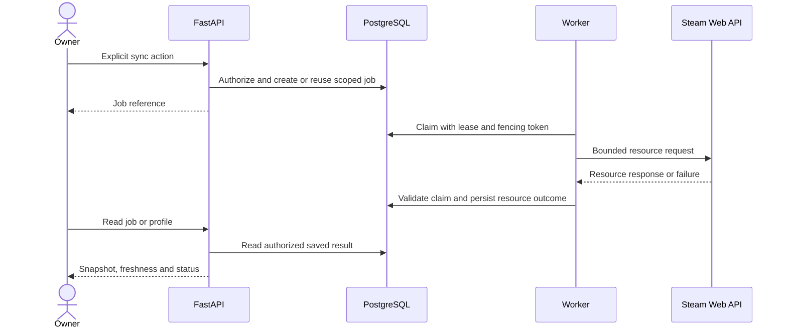
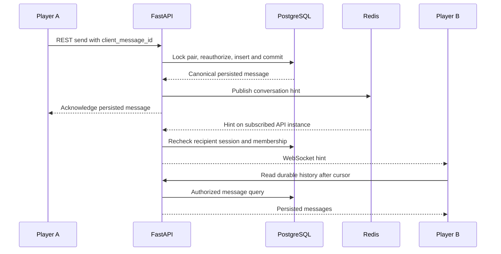

# Architecture overview

[SteamScope](../../README.md) · [Case study](CASE_STUDY.md) · [Professor demo](PROFESSOR_DEMO.md)

This is a presentation guide to the accepted local MVP at commit `4f8938d74455799d1712aa5fa670fe14f7eab675`, not a proposal to replace its architecture. The [README architecture diagram](../../README.md#architecture) are the compact starting point.

## Five processes, one backend codebase

The Next.js frontend serves the browser and proxies same-origin REST/WebSocket traffic. FastAPI is the application boundary. PostgreSQL holds accounts, imported snapshots, durable jobs, social relationships, notifications and messages. Redis holds rate-limit counters, transient presence/typing and Pub/Sub hints. An independent Worker runs the same backend package and claims Steam work from PostgreSQL.

The browser never receives the Web API key. Steam OpenID authentication is a separate identity flow: browser to the official Steam sign-in page, followed by a server-verified callback. The Worker is responsible for Web API data imports, not user password handling.

| Responsibility shown in the architecture | Actual implementation boundary                                    |
| ---------------------------------------- | ----------------------------------------------------------------- |
| Auth                                     | `modules/auth`, `modules/users`, `modules/privacy`, account API   |
| Steam                                    | `modules/steam`, Steam APIs and `worker.py`                       |
| Profiles                                 | `modules/players`, authorized persisted projections               |
| Discovery                                | `modules/social/discovery.py`, visible-evidence scoring           |
| Social                                   | `modules/social/service.py` and `policy.py`                       |
| Chat                                     | `modules/chat`, REST adapter and authenticated socket adapter     |
| Notifications                            | Persistent social-domain notification rows and recipient APIs     |
| Moderation                               | User/message report intake and bounded retention; no moderator UI |

These are domains within a modular monolith, not eight independently deployed services. The [module boundary document](../architecture/MODULE_BOUNDARIES.md) and [backend source](../../backend/src/steamscope_social) provide the implementation map.

## Two paths with different failure semantics

### Explicit Steam synchronization

The claim is committed before the network call. Resource writes verify the account/link, import generation, claim token and lease. This prevents an expired Worker or an in-flight response after data clearing from restoring invalid data. Each resource can succeed, retry or fail independently. Shared schema cache leases avoid duplicate refresh work.

PostgreSQL owns the queue and request budgets; Redis is not the durable synchronization queue. [Lease design](../adr/0022-steam-sync-leases-snapshots-limits.md) · [Schema coordination](../adr/0023-selected-achievements-and-steam-friends.md)

### Persistent chat with transient delivery

The diagram shows the successful path. Redis failure before rate-limit authorization rejects a new send; failure to publish after commit does not undo the message. Lost hints are recovered through history reads. A retry with the same sender/client ID returns the existing logical message; conflicting reuse is rejected.

There is no exactly-once WebSocket claim, Redis message archive or end-to-end encryption. [Chat contract](../architecture/DIRECT_CHAT.md) · [Chat decision](../adr/0026-persistent-direct-chat.md)

## Data relationships worth explaining

| Separation or invariant                                  | Why it matters                                                                                   |
| -------------------------------------------------------- | ------------------------------------------------------------------------------------------------ |
| UUID user vs. external Steam identity                    | Sessions, ownership and platform relationships do not use a public Steam identifier as authority |
| Shared game/schema vs. per-user snapshots                | Definitions can be reused while individual progress and visibility remain independent            |
| Imported Steam friends vs. accepted platform connections | A source friendship never silently grants messaging or private-data access                       |
| Directed request/block vs. canonical connection pair     | Request intent is directional; one relationship must survive concurrent A–B/B–A attempts         |
| Pair conversation vs. explicit members                   | Exactly one logical direct conversation, with database membership constraints                    |
| Message sequence vs. client message ID                   | Sequence orders durable history; client ID deduplicates retries                                  |
| Stored read cursor vs. transient presence/typing         | Read state survives refresh; connection liveness and drafts do not become history                |

See the [physical model](../database/DATA_MODEL.md) for both-party foreign keys and report retention. The simplified ER diagram does not imply that every shown edge is a single physical foreign key.

## Read authorization is part of the query

Profile and resource visibility, source exposure/freshness, connection status and blocks determine which evidence can be projected. Only then can the application count games, sum minutes, intersect libraries or score candidates. A hidden value must not affect a rank or aggregate even if the UI omits its raw field.

Owner-visible stale data remains explicitly historical. Non-owner projections require the permitted current evidence. Missing recent minutes stay unknown. Complete achievement percentages require matching fresh schema/progress and a nonzero denominator.

[Player policy](../architecture/PLAYER_VIEWS.md) · [Discovery formula and limits](../architecture/SOCIAL_GRAPH.md)

## Deliberate tradeoffs

- **Modular monolith:** one deployable API and shared transactions simplify consistency. No microservice scalability claim is made.
- **Bounded discovery:** deterministic scoring within a limited eligible pool is explainable; it is not an exhaustive global ranking or a machine-learning model.
- **Transient sockets:** Pub/Sub plus periodic policy checks is simple enough for this local MVP. Per-socket subscriptions and database checks have not been production load-tested.
- **Privacy over convenient numbers:** Unknown and stale states reduce the appearance of completeness but prevent misleading progress and comparison results.
- **Explicit erasure:** deleting an account removes its paired chat histories, including peer messages in those conversations. Clearing Steam data is a separate operation.
- **Operational work remains:** remote CI execution, production security, backups, moderation operations, retention scheduling and public deployment are not completed by local functional acceptance.

## Evidence map for a technical reviewer

| Claim                                             | Source and test evidence                                                                                                                                                                                                 |
| ------------------------------------------------- | ------------------------------------------------------------------------------------------------------------------------------------------------------------------------------------------------------------------------ |
| API/Worker share a bounded durable pipeline       | [Steam jobs](../../backend/src/steamscope_social/modules/steam/jobs.py), [integrated Steam acceptance](../development/VALIDATION.md)                                                                            |
| Privacy applies before comparison/scoring         | [Player service](../../backend/src/steamscope_social/modules/players/service.py), [discovery](../../backend/src/steamscope_social/modules/social/discovery.py), [privacy matrix](../security/PRIVACY_MODEL.md)           |
| Concurrent relationships remain unique            | [Social integration tests](../../backend/tests/integration/test_social.py)                                                                                                                                               |
| Messages commit before hints and deduplicate      | [Chat service](../../backend/src/steamscope_social/modules/chat/service.py), [transaction tests](../../backend/tests/integration/test_chat.py), [process-crash test](../../backend/tests/integration/test_chat_crash.py) |
| Socket policy changes and gap recovery are tested | [WebSocket integration tests](../../backend/tests/integration/test_chat_websocket.py), [browser flow](../../frontend/tests/auth-e2e/chat.spec.ts)                                                                        |
| Latest local results and real-user boundaries     | [Historical and current validation summary](../development/VALIDATION.md)                                                                                                                |

Historical design documents retain earlier phase-specific limitations. Current implemented chat behavior is defined by DIRECT_CHAT and the public validation summary; an older “planned” label is not a new implementation task.
